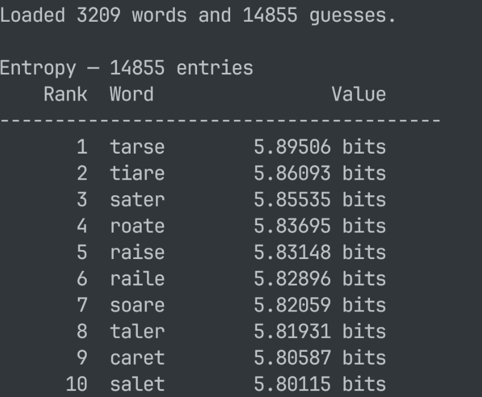
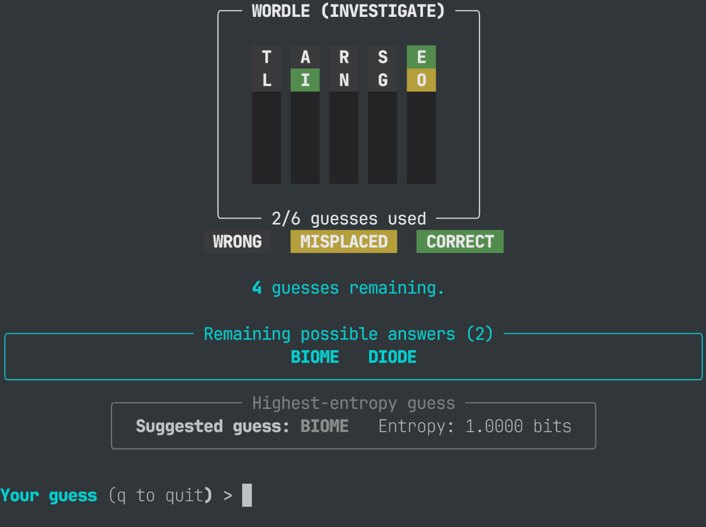

# Wordle

A hobby project for noodling around Wordle.
It includes:

- A small C extension that does the matching and calculations, because python is
  WAY too slow.
- a stats CLI that ranks every word and letter.
- A terminal game that includes various game modes.

## The C library

`wordle_lib` exposes three things:

- `match(guess, word)` → five values: `0` wrong, `1` misplaced, `2` correct
- `calc_entropy(guesses, words)` → bits of information per guess
- `calc_points(guesses, words)` → total positional score per guess

## The Statistics

### Letter Frequency

How often each letter shows up in the answer list. Duplicates within a word
count once.

```text
freq(letter) = answers containing letter / total answers
```

`e` is at the top with about 49%.

### Entropy

For each guess, go through all the words in the answer list and produce the
pattern. There are 3^5 - 5 = 238 possible patterns.

```text
H(guess) = -Σ p_i · log2(p_i)
p_i      = answers producing pattern i / total answers
```

Higher entropy means a more uniform distribution of each pattern, which
introduces more information, and is measured in bits. It's the number the
terminal game uses when recommending a guess.

### Points

Match the guess against every answer and add up the values, where gray = 0,
yellow = 1, green = 2.

```text
P(guess) = Σ_answers Σ_tiles board(guess, answer)[tile]
```

Points are here because they're the intuitive gauge people think of when trying
to tell whether an answer is good or not. It's easy to compute and fun to look
at. And, they're also not that far from entropy, if you look at it.

### The Stats CLI

The rankings are cached in `stats/*.csv` (ignored by git). `-U` ignores the
cache, recalculates, and rewrites it.

```bash
uv run analysis.py -l                  # top 10 letter frequencies (default action)
uv run analysis.py -e --top 20         # top 20 by entropy
uv run analysis.py -p --last           # bottom 10 by points
uv run analysis.py -l --rank 5 3       # letter at rank 5, 3 on each side
uv run analysis.py -e --lookup tarse   # default lookaround is 5 each side
uv run analysis.py -e --save           # just entropy
uv run analysis.py --save              # every dataset
uv run analysis.py -e --top -U         # force a recalculation
```

Pick a dataset with `-l` / `-e` / `-p`. If you don't pick an action it does a
top-10; `--rank` and `--lookup` take an optional count for how many entries to
show on each side.



## The Game

```bash
uv run game.py            # normal game
uv run game.py -w raise   # normal game with a known answer
uv run game.py -i         # investigate mode
uv run game.py -f         # free mode
```

There are three modes:

- **normal** — a random answer, six guesses. The normal game.
- **investigate** (`-i`) — same game, but shows the current best entropy guess
  and the possible answers.
- **free** (`-f`) — for when you're playing somewhere else. You type the guess
  and the feedback yourself as five digits: `0` gray, `1` yellow, `2` green.
  The answer is unknown, but it keeps track of the candidate list and the best
  guesses.



## Running it

Needs Python 3.14, uv, and a C compiler.

```bash
uv sync
uv run game.py
```

This is a uv workspace: the root `wordle` project and `wordle-lib` share one
lockfile and one `.venv`. `wordle-lib` is installed **non-editable**, so after
changing the wrapper or the C source, rebuild it with:

```bash
uv sync --reinstall-package wordle-lib
```

The C code is formatted with clang-format using Microsoft style
(`wordle-lib/.clang-format`).

## The Data

- `data/words.txt` — 3,209 possible answers
- `data/guesses.txt` — 14,855 accepted guesses (a superset of the answers)

They're Python list literals on a single line, loaded with `eval` (probably not
the best approach, but i'm not changing it :D)

## Credits

This was heavily inspired by [3Blue1Brown's video on information theory](https://www.youtube.com/watch?v=v68zYyaEmEA).

I built it with the help of AI, which helped optimizing the
algorithm, setting up the workspace and writing some boilerplate code.
